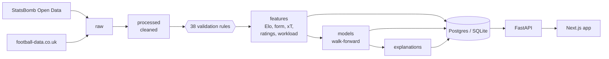

# Barça Intelligence

An end-to-end football analytics platform for FC Barcelona, built on
StatsBomb's open event data: a validated data pipeline, team and player
analytics, a calibrated match-outcome model, starting-XI prediction,
explainable AI, a FastAPI service and an interactive Next.js app.

The data ends in 2021, so the app **replays history**: pick any Barcelona
fixture from 2008/09 to 2020/21 and it shows exactly what the platform would
have said on the morning of that match (prediction, predicted XI, workload,
form), with the result hidden until you reveal it.


## Highlights

- **3.1 million events** from 869 matches (17 Barcelona seasons, the complete
  2015/16 La Liga, three Champions League finals), joined to **10,044 La Liga
  results** since 1995/96.
- **38 football-aware data-quality rules** with a hard gate: the feature
  stage will not run on data that failed. Events reproduce all 869 official
  scores, and the two sources agree on every league match.
- **Leakage is tested, not assumed**: a future-scrambling test on the real
  data rebuilds every feature after randomising all later results and
  requires nothing earlier to change.
- **Match-outcome ensemble** (Elo ordered logit + Poisson goals model +
  LightGBM), selected on 2008-2014 and scored once on the 2014-2021 holdout:
  log loss **0.968** against the betting market's **0.953**, closing **87%** of
  the gap between base rates and the market, from results alone. Calibration
  error 0.017, level with the market.
- **Starting-XI model**: **8.99 of 11** starters right on the holdout seasons,
  with a formation-aware assignment and plain-language reasons for each pick.
- **Explanations for every prediction**: permutation SHAP of the shipped
  ensemble (not a proxy model), grouped permutation importance, PDP/ICE, and an
  automated audit that catches a deliberately leaky model.
- **Player analytics**: expected threat, a transparent position-aware player
  rating (BIPR), match ratings, interactive action heatmaps, and a workload
  index that is explicitly *not* a fatigue measure.
- **Production shape**: Postgres or SQLite behind FastAPI (every endpoint
  under 15 ms), Docker Compose, GitHub Actions running unit, integration
  (on both databases), data-quality and browser tests.

## Screenshots

| Match centre: prediction, predicted XI and SHAP explanation | After the reveal: shot map |
|---|---|
|  |  |

| Player profile: rating pillars, trends, action heatmap, workload | Model intelligence: holdout metrics, calibration, explanations |
|---|---|
|  |  |

Every page also works on a phone:


## How it works



| Stage | Notebooks | Documentation |
|---|---|---|
| Data discovery and EDA | 01-06 | [EDA findings](docs/eda-findings.md), [data sources](docs/data-sources.md) |
| Profiling, quality, cleaning | 07-08 | [Data quality](docs/data-quality.md), [data dictionary](docs/data-dictionary.md) |
| Features | 09 | [Feature engineering](docs/feature-engineering.md) |
| Ratings and workload | 10-11 | [Model methodology § Ratings](docs/model-methodology.md#ratings), [workload](docs/workload-methodology.md) |
| Outcome models and evaluation | 12-14 | [Model methodology](docs/model-methodology.md) |
| Explainability | 15 | [XAI methodology](docs/xai-methodology.md) |
| Starting XI | 16 | [Model methodology § Starting XI](docs/model-methodology.md#starting-xi) |
| API, app, deployment | | [Architecture](docs/architecture.md), [deployment](docs/deployment.md) |

What the platform cannot do is set out in [limitations](docs/limitations.md).
Every significant choice, including the ideas the data rejected, is in the
[decision log](docs/decision-log.md).

## Results

Walk-forward: each season is predicted by a model trained only on earlier
seasons. Holdout = 2014/15-2020/21, never used for any decision.

| Holdout, all La Liga (2,660 matches) | Log loss | RPS | Accuracy |
|---|---|---|---|
| Betting market (average odds) | 0.953 | 0.190 | 54.1% |
| **Ensemble (production)** | **0.968** | **0.194** | **52.9%** |
| Elo alone | 0.970 | 0.195 | 53.0% |
| LightGBM alone | 0.974 | 0.195 | 52.7% |
| Base rates | 1.066 | 0.227 | 45.6% |

On Barcelona's 266 holdout matches: log loss 0.758 (market 0.749),
accuracy 71.8%. The market stays ahead because it prices team news; where
the two disagree most, the market is usually right, so the model is not a
betting tool.

## Quickstart

Requirements: Python 3.12, [uv](https://docs.astral.sh/uv/), Node.js 20.9+.
Docker is optional.

```bash
git clone <repository-url> barca-intelligence && cd barca-intelligence
make install      # Python and web dependencies
make pipeline     # download, validate, build features, train, explain, load ./barca.db
make api          # http://localhost:8000/docs
make web          # http://localhost:3000
```

Or with PostgreSQL in Docker, after `make pipeline`:

```bash
make up           # Postgres + API + web
```

`make help` lists every target. The tests that need no data run with
`make test`; see [deployment](docs/deployment.md) for the rest.

## Repository layout

```
src/barca/       the Python package: data, analytics, features, models, xai, db, cli
apps/api/        FastAPI service and Alembic migrations
apps/web/        Next.js app and Playwright tests
notebooks/       16 executed analysis notebooks, in milestone order
reports/         generated reports (coverage, profile, data quality, feature catalogue) and figures
docs/            methodology, architecture, limitations, decision log
tests/           unit, integration and data-quality suites
```

## Tech stack

Python 3.12 · Polars · pandas · Parquet · scikit-learn · LightGBM ·
XGBoost · SHAP · Optuna · MLflow · SQLAlchemy · Alembic · PostgreSQL ·
FastAPI · Next.js 16 · TypeScript · Tailwind · shadcn/ui · SVG · Recharts ·
TanStack Query · pytest · Playwright · Docker · GitHub Actions

## Data and licence

Event data: [StatsBomb Open Data](https://github.com/statsbomb/open-data).
Results and odds: [football-data.co.uk](https://www.football-data.co.uk).
The data is **not included** in this repository. The StatsBomb user
agreement does not allow redistribution, so `make data` downloads it from
the original sources at a pinned version.

<a href="https://statsbomb.com"></a>

The source code is not open source: it is © 2026 Manshul Budholiya, all
rights reserved (see [LICENSE](LICENSE)). The licence does not cover the data. This is an independent project, not affiliated with or
endorsed by FC Barcelona.
