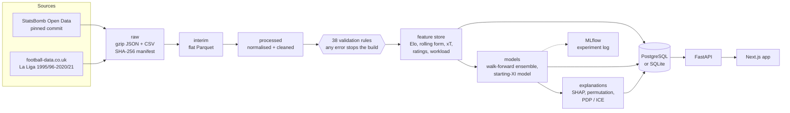

# Architecture

The platform is a batch data pipeline that ends in a read-only web application.
Every stage writes files that the next stage reads, so each one can be rerun,
inspected and tested on its own.



| Stage | Command | Code | Output |
|---|---|---|---|
| Download | `barca fetch` | `barca.data.load` | `data/raw/` + `MANIFEST.json` |
| Flatten | `barca interim` | `barca.data.parse` | `data/interim/*.parquet` |
| Normalise, clean, validate | `barca build` | `barca.data.normalize`, `clean`, `validate` | `data/processed/`, `reports/data_quality.md`, validation stamp |
| Features | `barca features` | `barca.features`, `barca.analytics` | `data/features/*.parquet` |
| Models | `barca train` | `barca.models` | `models/match_outcome/`, `models/lineup/`, MLflow runs |
| Explanations | `barca explain` | `barca.xai` | `models/match_outcome/explanations_barca.parquet`, `global_explanations.json` |
| Database | `barca db` | `barca.db` | the application database (Alembic schema + bulk load) |
| Serve | `make api`, `make web` | `apps/api`, `apps/web` | HTTP API on :8000, web app on :3000 |

`make pipeline` runs the batch stages in order.

## Design principles

**Everything is "as of" a date.** Every feature, rating, workload value and
prediction for a fixture is computed only from matches played before it.
The app uses this to replay history: pick any Barcelona match from 2008/09
onwards and it shows what the platform would have said on the morning of
that match, with the result hidden until you reveal it
([D-004](decision-log.md#d-004---as-of-design-the-platform-replays-history)).

**Leakage is tested, not assumed.** Rolling features are built with one
shift-then-window mechanism. A future-scrambling test rebuilds the features
after randomising every result from a cutoff date and requires everything up
to the cutoff to be unchanged. Models are evaluated walk-forward only
([D-020](decision-log.md#d-020---rolling-windows-cross-season-schedule-anchored-coverage-aware)).

**A data-quality gate, not only a report.** `barca build` writes a stamp
only when every error-level rule passes, and the feature stage refuses to run
without it ([D-016](decision-log.md#d-016---type-aware-validation-with-a-hard-gate-before-features)).

**One definition per metric.** Progressive passes, PPDA, box entries and the
heatmap action families are Polars expressions in
`barca.analytics.definitions`. Team stats, player stats, the database loader
and the API all import them
([D-012](decision-log.md#d-012---one-definitions-module-for-every-football-metric)).

**The serving side never trains.** The API reads a database that the batch
pipeline loaded. Its Docker image installs the core package plus FastAPI
only: no LightGBM, SHAP or MLflow.

## Repository layout

```
src/barca/
  data/          sources, download, parsing, normalisation, cleaning, validation, profiling
  analytics/     metric definitions, team/player match stats, spatial analysis, xT, ratings, workload
  features/      rolling form, Elo, event form, fixture tables, player-fixture table
  models/        baselines, gradient boosting, ensemble, backtesting, production training, lineup model
  xai/           SHAP, permutation importance, PDP/ICE, leakage audit, error analysis, labels
  db/            SQLAlchemy models, engine/session, migrations runner, loader
  visualization/ matplotlib style used by the notebooks
  cli.py         the `barca` command
apps/api/        FastAPI service, Alembic migrations
apps/web/        Next.js app, Playwright tests
notebooks/       16 analysis notebooks, executed, in milestone order
reports/         generated reports and figures
tests/           unit, integration (API + migrations) and data-quality suites
```

## Storage

- **Parquet** for every pipeline stage. Events are partitioned by season
  (hive layout) and read lazily with Polars, so no stage holds the 3.1 million
  events in memory unless it needs them.
- **Application database.** One schema, two engines: SQLite for local
  development and tests, PostgreSQL in Docker. Column types are portable
  (`JSON` rather than `JSONB`). On Postgres the loader uses `COPY`, which
  loads the 1.2 million event rows in under a minute. The API responses are
  identical on both engines; that was checked endpoint by endpoint.
- **Model artefacts** (`models/`) are joblib files, one ensemble per test
  season, plus a model card with metrics. MLflow keeps every experiment run
  in a local SQLite store.

## Application database

| Table | Rows | Contents |
|---|---|---|
| `competitions`, `seasons`, `teams`, `players` | 2 / 26 / 49 / 2,360 | reference entities |
| `matches` | 649 | Barcelona matches (with events where StatsBomb has them) and fixtures with predictions |
| `lineups` | 17,404 | player spells per match: start, minutes, positions |
| `events` | 1.23 M | Barcelona players' on-ball actions and every shot, with action-family flags and xT |
| `team_match_stats`, `player_match_stats` | 1,054 / 14,718 | per-match statistics |
| `team_features` | 12,920 | pre-match form and Elo per team and fixture |
| `player_season_ratings` | 412 | BIPR pillars and per-90 metrics |
| `player_fixtures` | 11,417 | per-fixture candidate table: start probability, predicted slot, workload, selection reasons |
| `model_versions`, `predictions` | 2 / 494 | model cards and every Barcelona prediction with its explanation |

Migrations live in `apps/api/migrations` and are applied by `barca db`
(or `alembic upgrade head`). A test checks that the migrated schema matches
the ORM models exactly.

## API

FastAPI with typed Pydantic responses; the OpenAPI schema generates the web
app's TypeScript types (`npm run api:types`). Every endpoint answers in
under 15 ms on the full database.

| Endpoint | Returns |
|---|---|
| `GET /api/overview?as_of=` | next match, prediction, form, readiness, workload leaders, season record |
| `GET /api/seasons`, `/api/teams`, `/api/teams/{id}/form` | reference lists and team form |
| `GET /api/matches`, `/api/matches/{id}` | fixture list; one match with prediction, lineup and stats |
| `GET /api/matches/{id}/shots`, `/passes` | shot map; pass network until the first substitution |
| `GET /api/players`, `/api/players/{id}` | squad list; profile with ratings |
| `GET /api/players/{id}/stats`, `/heatmap`, `/workload` | match history; heatmap by window and action family; workload history |
| `GET /api/predictions/match/{id}`, `/lineup/{id}` | outcome prediction with SHAP; predicted XI with reasons |
| `GET /api/models`, `/api/models/{id}`, `/explanation` | model cards, evaluation, global explanations |

## Web app

Next.js 16 (App Router) with TypeScript, Tailwind, shadcn/ui, TanStack Query
for data fetching, hand-written SVG components for pitch graphics, Recharts for
line charts and Motion for transitions. Pages: overview, match centre,
fixtures, players, player profile, model intelligence and methodology. The
chart palette was checked for colour-vision deficiency and contrast, and
results always carry a W/D/L letter as well as a colour.

## Testing

| Suite | Runs against | What it covers |
|---|---|---|
| `tests/unit` | synthetic data | metrics, definitions, normalisation, Elo, leakage mechanics, workload, ratings, validation rules, loader |
| `tests/integration` | a seeded SQLite or Postgres database | every API endpoint, migrations vs ORM |
| `tests/data_quality` | the built data | all validation rules, real-data future-scrambling leakage test |
| `apps/web/e2e` | production web build, API mocked from fixtures | desktop and mobile journeys |

CI runs all four ([deployment.md](deployment.md#continuous-integration)).
