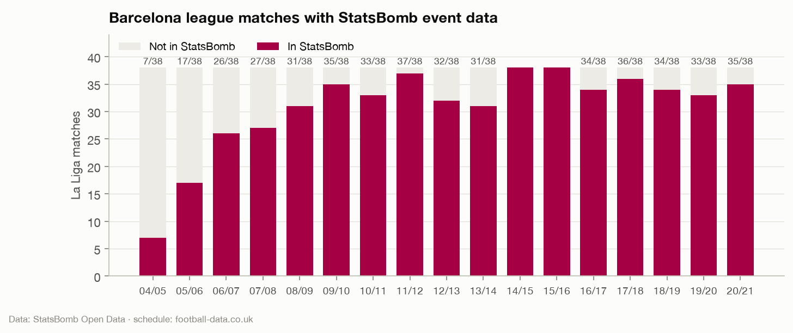
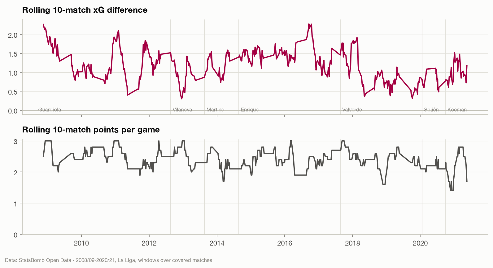
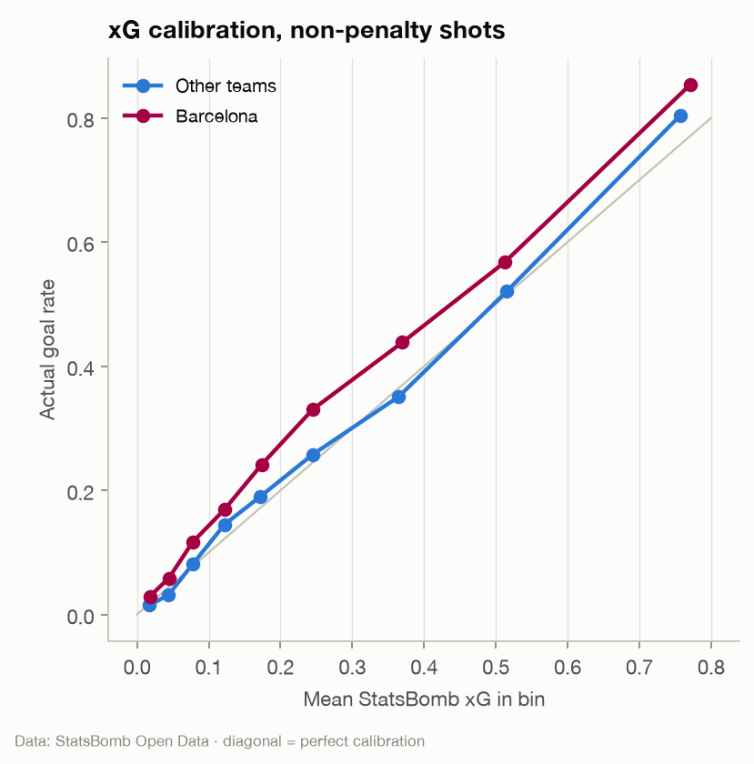
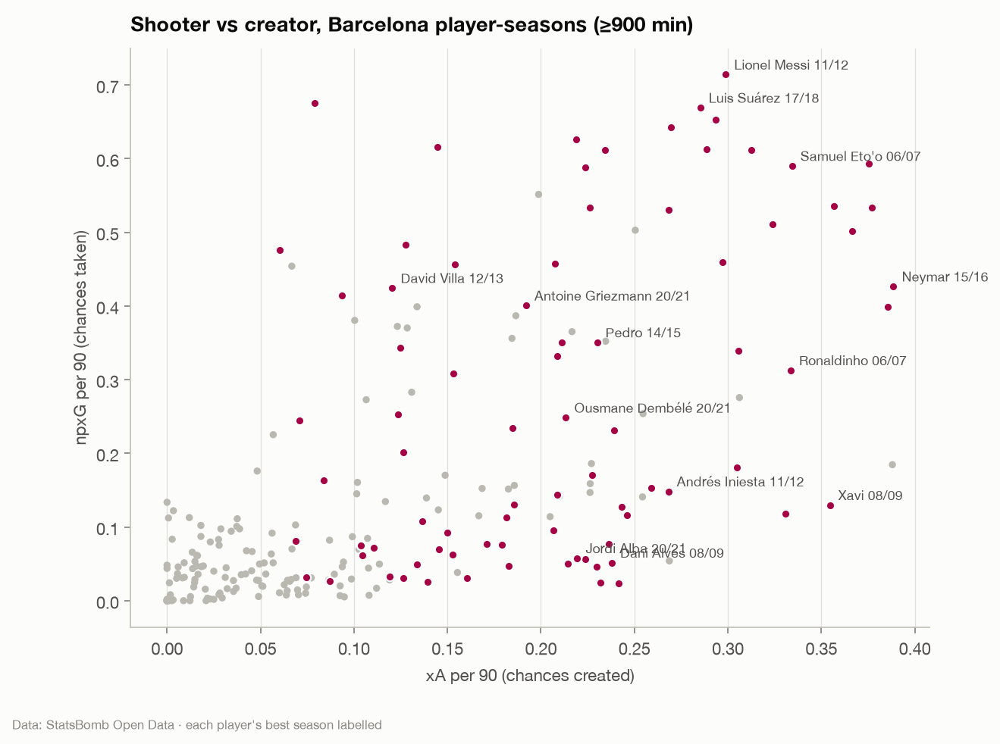
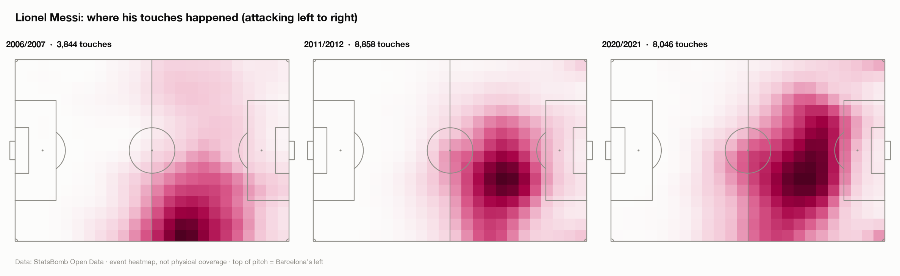
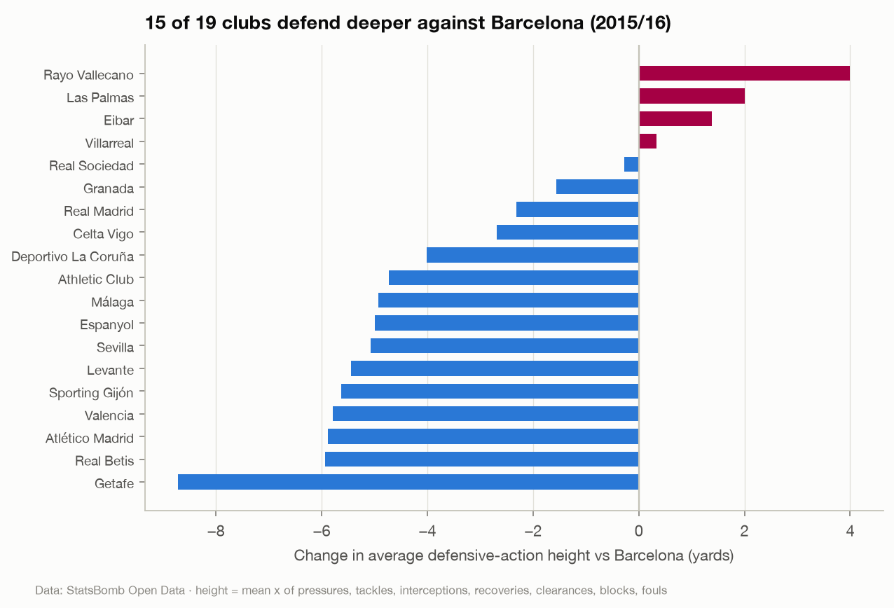

# Exploratory analysis: what the data says

The findings from notebooks 01-06, and the design decision each one led to.
Figures are generated by the notebooks into `reports/figures/`.

## 1. Coverage shapes everything (notebook 01)

- The core unit is a **Barcelona league match, 2004/05-2020/21**. Coverage is
  thin and biased before 2008/09: 2004/05 has 7 of 38 matches, and covered
  matches in the early seasons have a clearly higher points-per-game than
  the missing ones because they were selected around Messi.
- **Outside 2015/16, opponents only appear against Barcelona.** Opponent
  strength and form therefore have to come from the complete football-data
  schedule, not from events.
- **Cup and European matches are missing**, so any workload measure counts
  observed league minutes only.
- **Missingness is structural.** Most columns of the wide event table are
  null for most event types by design, so validation has to be type-aware.
- **The two sources agree on every result**, so joining on date and teams is
  safe.

→ Reliable-era window from 2008/09 for evaluation (D-018); football-data +
Elo for opponents (D-002, D-019); type-aware validation (D-016); workload
labelled "observed league workload" (D-024).

## 2. Results and underlying performance (notebook 02)

- **Performance peaked 2008/09-2016/17 and declined after 2018/19**, in
  results and in xG difference alike. The decline is mostly defensive: xG
  against rose from about 0.7-0.8 to about 1.0 a match.
- **Past xG difference predicts future points better than past points do**
  over a 10-match horizon, so rolling xG features were worth building.
- **Barcelona outscore their xG massively** (+0.56 non-penalty goals a match)
  while conceding what xG predicts.
- **Home advantage is large and stable** (league-wide home win rate about 47%).
- **Opponent quality dominates** where points are dropped.

## 3. Inside the event stream (notebook 03)

- StatsBomb xG is **well calibrated for the league as a whole** (1.01 goals
  per xG) but **Barcelona sit above the diagonal across the whole range**
  (1.31 goals per xG), for high-quality chances too, not only long shots.
- What can be derived: per-90 output, progression, pressing (PPDA,
  counterpressing, defensive height), possession value (xT), heatmaps, pass
  networks, formations. What cannot: off-ball movement, physical load, and
  positions away from the ball. **Heatmaps are action heatmaps**, and the
  app says so (D-015).

## 4. Players (notebook 04)

- **Per-90 rates need at least 900 minutes** to be meaningful. Below that the
  app shows the numbers with a low-sample flag instead of a rating (D-013).
- **Barcelona's attack is Messi-shaped**: the highest combined npxG + xA of
  any player-season in the data, and about half of the team's finishing
  over-performance.
- **Finishing over-performance does not persist season to season** for
  most players (year-on-year r ≈ −0.1). xG is the stable short-term signal;
  Messi is the exception over a career.
- **Midfielders progress the ball in two distinct ways**, passing and
  carrying, so the rating counts both.
- **Raw defensive counts mislead for a possession team.** In 2015/16 the
  median Barcelona player made fewer raw tackles and interceptions than the
  league median; after possession adjustment they made more tackles and
  pressures and as many interceptions (D-013).

## 5. Space (notebook 05)

- Heatmaps capture **roles and role changes**: Messi's arc from right winger
  to false nine to deep playmaker, full-backs whose average touch is
  further upfield than a central midfielder's.
- **Action filters matter**: the same player looks different through
  passes, carries, attacking and defending actions, so the app exposes them.
- **Roles stabilise within about five matches**, which made "last 5" the
  default heatmap window.
- **Barcelona's positional-play fingerprint is measurable**: more actions in
  the attacking third, concentrated in the half-spaces and centre.
- In 2020/21's 360 data, final-third passes are completed most often with
  one to three opponents within 10 yards (about 85%) and less often with five
  or more (about 72%). One season only, so it stays in the EDA.

## 6. Opponents (notebook 06)

- **Opponents change their game against Barcelona**: less possession, a
  deeper block, less pressing, consistently over 17 seasons.
- Against the top quartile of opponents Barcelona's win rate falls to 62%
  (80% against the bottom quartile), and losses more than double.
- **Relative statistics separate results only if their signs are
  consistent.** The plan's `AttackDiff = attack − opponent defence`, with
  goals conceded as "defence", mixes a higher-is-better and a
  higher-is-worse measure and does not separate results at all. A
  sign-consistent strength difference does: Barcelona's win rate rises from
  59% to 80% across its quartiles (D-014).

## What carried forward

| Finding | Where it went |
|---|---|
| Opponent strength is first-order | Elo for every club since 1995/96; it ends up carrying most of the model |
| xG difference predicts better than points | rolling xG features (they did not beat Elo in the end: D-027) |
| Relative features need consistent signs | `strength_diff`, matchup terms (D-014) |
| Per-90 noise below 900 minutes | rating threshold and low-sample flag |
| Possession distorts defending counts | possession-adjusted defending in ratings |
| Roles stabilise in ~5 matches | default heatmap window, lineup features over the last 5 |
| Missing cup/European matches | workload index documented as observed league workload |
