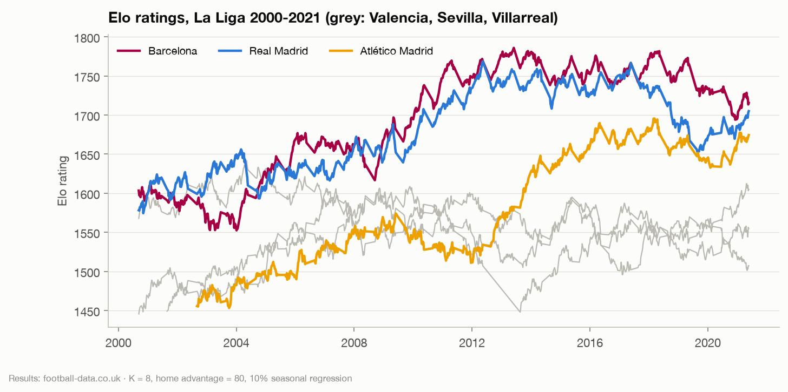
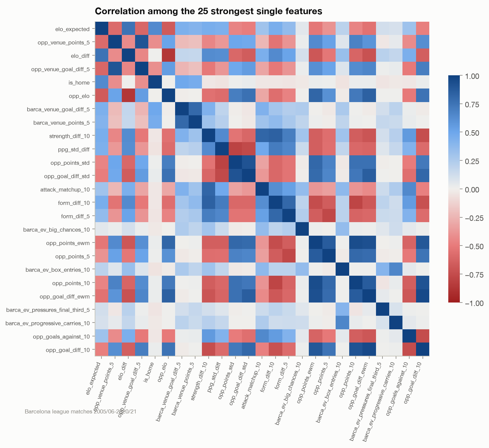

# Feature engineering

Every feature describes a fixture **as it looked before kick-off**. That
rule is enforced by one mechanism and checked by tests on both synthetic and
real data. The full list of the 90 league-model features, with
descriptions, is generated into `reports/feature_catalog.md`
(notebook 09).

## Where features come from

| Source | Coverage | Feature families |
|---|---|---|
| football-data results | every La Liga club, 1995/96-2020/21 | rolling form, venue form, season to date, head-to-head, rest, Elo |
| StatsBomb events | Barcelona every season; every club in 2015/16 | rolling xG, chances, possession, field tilt, PPDA, progression, pressing |
| Lineups + events | Barcelona players | minutes, starts, workload, match ratings (for the lineup model) |

The outcome model is trained on **every league fixture from 2005/06**
(up to 5,700 matches for the last test season), not only Barcelona's. A
Barcelona-only model was tried and was much worse.

## Rolling form (`barca.features.rolling`, `team_form`)

For each club and fixture, means over the last 3, 5 and 10 league matches of
points, goals for and against, goal difference, shots, shots on target and
corners (both for and against), plus:

- exponentially weighted points and goal difference (half-life 6 matches),
- points and goal difference over the last 5 home (or away) matches,
- season-to-date points and goal difference per game, and matches played,
- head-to-head points and goal difference over the last 4 meetings,
- days since the previous league match.

Windows run **across season boundaries**: resetting form every August
throws away real information, and `matches_played` tells the model how much
of the current season it is looking at.

**The leak-free mechanism.** Every rolling feature is computed the same way:
sort by date within the club, shift by one match, then take the window.
The current match can never enter its own features. Nulls stay nulls (a
club's first matches have short windows), and the model sees how many
matches a window contains.

## Elo (`barca.features.elo`)

A World-Football-style Elo over every league fixture since 1995/96:

- expected score `1 / (1 + 10^(−(elo_home + HFA − elo_away) / 400))`,
- update `K × G × (score − expected)`, where `G` grows with the goal margin,
- 10% regression to the league mean between seasons,
- promoted clubs start at the mean rating of the clubs they replace.

K = 8, home advantage = 80 and regression = 0.1 were chosen by grid search on
1996/97-2007/08 only, before any evaluation season, and the optimum is
interior. On 2008-2021 fixtures the expected home score matches the actual
one within 0.01-0.03 in every bin.
Nine seasons of burn-in mean every club has a settled rating by the first
StatsBomb match.

## Relative features, with consistent signs

The plan proposed `AttackDiff = attack − opponent defence`. Taken literally,
with goals conceded as "defence", it subtracts a higher-is-worse quantity
from a higher-is-better one, and it does not separate results. The relative
features are therefore all expressed so that higher means better for the
first side:

| Feature | Definition (first side minus second side) |
|---|---|
| `elo_diff` | Elo difference |
| `form_diff_5`, `form_diff_10` | points-per-game difference |
| `strength_diff_10` | (goals for − against) difference over 10 matches |
| `sot_strength_diff_10` | the same with shots on target |
| `attack_matchup_10` | own goals scored + opponent's goals conceded |
| `defence_matchup_10` | own goals conceded + opponent's goals scored |
| `ppg_std_diff` | season-to-date points-per-game difference |
| `rest_diff` | difference in days of rest |

## Event form (`barca.features.event_form`)

Rolling means of 25 StatsBomb team statistics (xG and xG against,
non-penalty xG, shots, big chances, open-play and set-piece xG, possession,
field tilt, PPDA, progressive passes and carries, pressures, counterpressing,
high recoveries, box entries, touches in the box, pass completion,
defensive action height) over 3, 5 and 10 matches.

StatsBomb does not cover every match, so windows are **anchored to the full
league schedule**: "last 5" means the last five league matches, and the
feature averages the ones among them that have event data. `ev_n_5` records
how many that was. Anchoring to covered matches only would let "last 5"
silently span months in the patchy early seasons.

Event form exists for Barcelona in every season and for every club in
2015/16. It is used by the Barcelona-specific experiments; it did not improve
outcome prediction and is not in the production model.

## Player features (`barca.features.player_fixture`)

One row per candidate player per Barcelona fixture, all computed from
earlier matches:

- minutes in the last 7, 14 and 30 days; appearances in the last 14 days;
  days since the last appearance and the last start,
- starts in the last 1, 3, 5 and 10 matches; consecutive starts; minutes in
  the last 5; times substituted off or brought on in the last 5,
- share of the season's matches started so far,
- form (minutes-weighted mean match rating of the last 5 rated appearances)
  and last season's BIPR,
- rank within the position family by recent starts, number of candidates in
  that family,
- the Workload Index and band ([workload-methodology.md](workload-methodology.md)),
- the opponent's Elo, the Elo gap and team rest days.

Candidates are the published matchday squad when it exists (every match
from 2015/16), otherwise every player who appeared in the previous 60 days.

## Proving there is no leakage

| Test | Where | What it checks |
|---|---|---|
| Rolling means ignore the current and later rows | `tests/unit/test_leakage.py` | the shift-then-window mechanism on a hand-built series |
| Future invariance of team form and Elo | `tests/unit/test_leakage.py` | scramble all results after a match, rebuild, require identical features up to it (synthetic double round robin) |
| Elo updates only after the match | `tests/unit/test_leakage.py` | pre-match rating unaffected by the match's own result |
| No targets or odds in feature lists | `tests/unit/test_leakage.py` | feature lists contain no result, goals or `mkt_` columns |
| Full-pipeline future scrambling | `tests/data_quality/test_feature_leakage.py` | on the real 10,044 fixtures, for three cutoffs (2008, 2015, 2020): scramble every result from the cutoff, rebuild the fixture table, require all 90 features of every fixture up to the cutoff to be unchanged |
| Event form uses earlier matches only | `tests/data_quality/test_feature_leakage.py` | multiply every xG from a cutoff by ten, rebuild event form, require every earlier value to be unchanged |

The future-scrambling test relies on each club playing at most once per
date, which validation rule R07 guarantees on the real schedule.

## What the features showed

Signal is concentrated in **opponent strength**, then **Barcelona's current
strength**, then **home advantage**. Many features are near-duplicates of
each other (opponent Elo ≈ opponent season points per game ≈ opponent goal
difference), which is why the linear baseline needs heavy regularisation and
why the explanations group correlated features before measuring their
importance ([xai-methodology.md](xai-methodology.md)).

