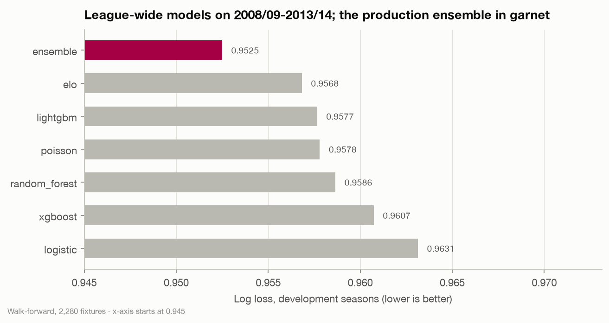
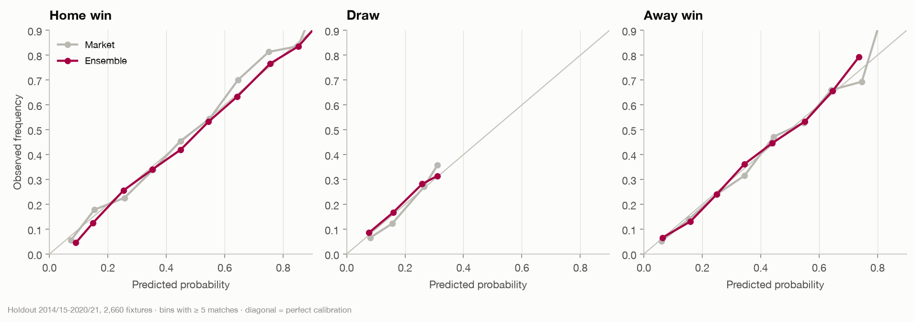
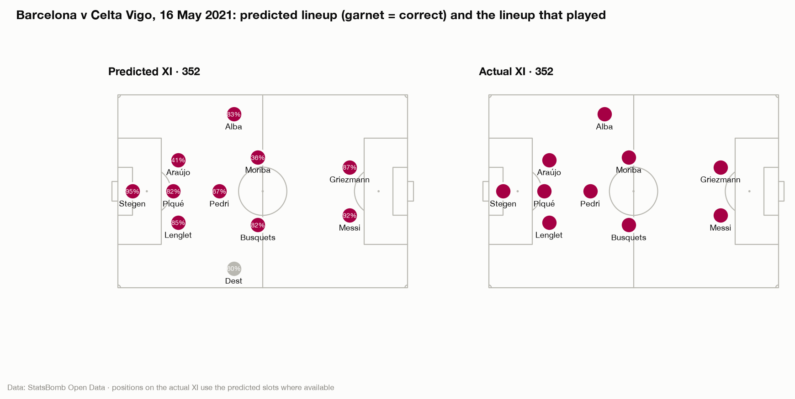
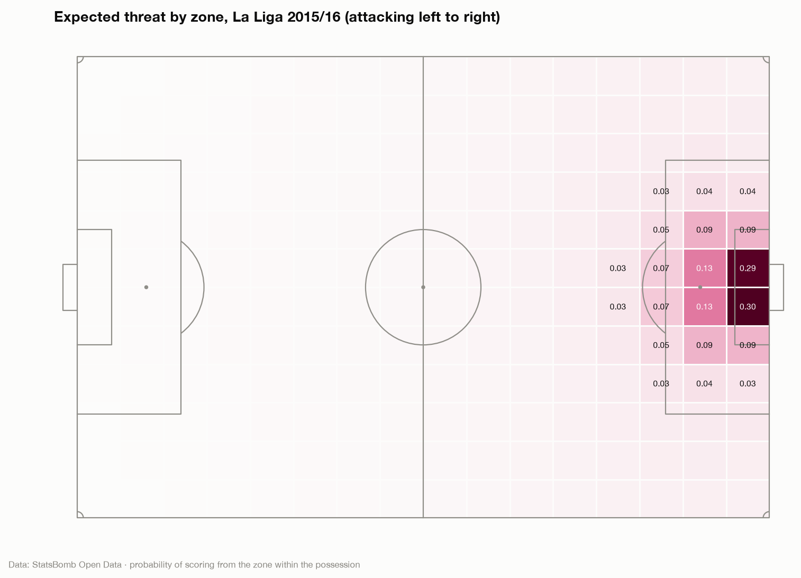

# Model methodology

Three kinds of model: the **match-outcome model** (win / draw / loss
probabilities and a score distribution), the **starting-XI model**, and the
descriptive **ratings** (xT, BIPR, match ratings). The first two are
evaluated walk-forward against honest baselines and, for outcomes, against
the betting market.

## Match outcome

### Target and data

A three-class outcome (home win, draw, away win) for every La Liga fixture,
with Barcelona's view derived from it (W / D / L). Training uses every club's
matches from 2005/06, the first season in which every results-based feature
exists.
The inputs are the 90 pre-match features described in
[feature-engineering.md](feature-engineering.md). Odds are never features.

### Evaluation protocol

**Walk-forward backtesting.** For each season S from 2008/09 to 2020/21, a
fresh model is trained on seasons before S and predicts every match of S.
Nothing about S, not a result and not a hyperparameter, reaches the model
that predicts it.

**Development and holdout seasons.** Every modelling decision (which
models, regularisation, ensemble composition, Poisson variant, calibration)
was made on the **development seasons 2008/09-2013/14** (2,280 fixtures).
The **holdout seasons 2014/15-2020/21** (2,660 fixtures) were scored once,
after the choices were frozen (notebook 14).

**Metrics.** Log loss is the headline, because the product shows
probabilities. Also reported: Brier score, ranked probability score (RPS,
which respects the order win > draw > loss), expected calibration error
(ECE), accuracy and macro-F1. Accuracy is reported but never optimised: it
ignores everything a probability says except which number is largest.

### Models

| Model | What it is |
|---|---|
| Naive | training-set base rates |
| Elo | ordered logit on the pre-match Elo difference |
| Logistic regression | L2-regularised multinomial logit on all features (C chosen on development seasons) |
| Poisson goals model | independent Poisson regressions for home and away goals on Elo, rolling goals and shots on target; outcome and scoreline probabilities from the goal distributions |
| Random forest | 600 bagged trees on all features, at least 25 samples per leaf |
| XGBoost, LightGBM | gradient-boosted trees on all features; the number of trees is set by early stopping on the last training season, a one-parameter temperature calibration is fitted on that season, then the model is refitted on the whole window |
| **Ensemble (production)** | equal-weight average of Elo, Poisson and LightGBM |

### Selection (development seasons)

| Model | Log loss |
|---|---|
| Naive | 1.042 |
| Logistic (C = 0.001) | 0.963 |
| XGBoost | 0.961 |
| Random forest | 0.959 |
| Poisson | 0.958 |
| LightGBM | 0.958 |
| Elo | 0.957 |
| **Ensemble** | **0.9525** |

The ensemble beat every single model. Elo + LightGBM alone scored the same
(0.9521); the Poisson member is kept because it also supplies expected goals
and scorelines, so outcome and score predictions come from one model.

### Holdout results (2014/15-2020/21, 2,660 fixtures)

| Model | Log loss | RPS | Accuracy | ECE |
|---|---|---|---|---|
| Betting market: average odds | 0.9529 | 0.190 | 54.1% | 0.019 |
| Betting market: Bet365 | 0.9537 | 0.190 | 54.0% | 0.014 |
| **Ensemble (production)** | **0.9677** | **0.194** | **52.9%** | **0.017** |
| Poisson | 0.9685 | 0.194 | 53.0% | 0.018 |
| Elo | 0.9701 | 0.195 | 53.0% | 0.023 |
| Logistic | 0.9716 | 0.195 | 53.0% | 0.018 |
| Random forest | 0.9722 | 0.195 | 52.9% | 0.017 |
| XGBoost | 0.9730 | 0.195 | 53.0% | 0.023 |
| LightGBM | 0.9743 | 0.195 | 52.7% | 0.020 |
| Naive | 1.0663 | 0.227 | 45.6% | 0.014 |

- The production ensemble is again the best model on seasons none of its
  design choices saw, even though the single-model ranking shuffled
  (LightGBM, level with Elo in development, is the weakest trained model on
  the holdout). That is the case for averaging.
- It **closes 87% of the gap** between base rates and the market's average
  odds, from results alone. Pinnacle's closing line (from 2012/13) is
  sharper still at 0.948.
- **Where the model disagrees most with the market, the market is right**:
  in the quintile of largest disagreement the model's log loss is 0.044
  worse. The missing information is mostly team news. The model is not a
  betting signal and is not presented as one.
- **Calibration** matches the market's (ECE 0.017 vs 0.019).
- **Stable by season**: the ensemble beats Elo in 10 of 13 seasons and tracks
  the market at a gap of 0.007-0.022 every season.
- **Barcelona's 266 holdout matches**: log loss 0.758 (market 0.749), 71.8%
  accuracy, against 0.790 for the holdout's own base rates, which no
  forecaster could have known in advance.

### Score model

The Poisson member's expected goals are unbiased on the holdout seasons
(2.64 predicted vs 2.66 actual goals a match; home 1.53 vs 1.52, away 1.10 vs
1.14) and track reality across buckets of predicted goals. The single most
likely scoreline is right in 13.4% of matches and the actual score is in the
top three 36.2% of the time, typical for football. The app shows scores as a
distribution, never as a pick.

### Known blind spot

Ratings built from results take months to register a step change. The model
under-rated Guardiola's first two seasons by 10.8 and 17.9 points: it
entered 2008/09 with the Elo of a Rijkaard side that had finished third.
From 2011/12, expected and actual points agree within about ±5 every
season.

## Starting XI

1. **Start probability.** A LightGBM classifier gives P(start) for every
   candidate in the matchday pool, from the player-fixture features (recent
   starts and minutes, consecutive starts, workload, form rating, last
   season's rating, position-family rank, opponent strength). Trained
   walk-forward with early stopping on the last training season.
2. **Formation.** The formation used most in the last five matches (right 78%
   of the time), with slot positions taken from the latest Starting XI in
   that formation.
3. **Assignment.** Players are assigned to slots by the Hungarian algorithm,
   maximising Σ log P(start) + λ · log(eligibility), where eligibility is the
   player's share of recent starts in the slot's position family. λ = 0.25
   was chosen on the development seasons. A much smaller term (weight 0.01)
   prefers each player's usual flank, so left-backs play on the left: 86% of
   wide slots go to a player on his usual side, against 57% without it. The
   lineup always contains exactly one goalkeeper.
4. **Reasons.** TreeSHAP of the start model, turned into short sentences
   ("Started 4 of the last 5", "Workload index 72") for the app's
   "Why selected?" panel.

| Holdout 2014/15-2020/21 (248 fixtures) | Correct starters (of 11) |
|---|---|
| Same XI as the previous match | 7.78 |
| Most regular starters | 8.84 |
| Top 11 start probabilities (invalid lineup in about 4% of matches) | 8.97 |
| **Model + positional assignment** | **8.99** (whole XI right in 12% of matches) |

## Ratings

### Expected threat (xT)

A 16 × 12 grid (Singh's formulation) fitted once on every match of La Liga
2015/16: the value of a cell is the probability that possession there ends
in a goal within the next actions, through shots (valued at the cell's mean
StatsBomb xG) or moves. Completed passes and carries are credited with the
xT difference between end and start. Fitting on a whole league season gives
a neutral value surface rather than one shaped by Barcelona's style. xT is
descriptive only and never enters the outcome model.

### BIPR: Barça Individual Player Rating

A season rating for outfield players with at least 900 league minutes.

1. **Seven pillars**, each the mean percentile of 2-5 per-90 metrics within the
   player's position family, against a **fixed reference population** (every
   outfield player-season with ≥ 900 minutes in La Liga 2015/16, the only
   complete league season):

   | Pillar | Metrics |
   |---|---|
   | Passing | completed passes, completion %, xT from passes, final-third entries |
   | Creation | xA, key passes, box entries, through balls |
   | Progression | progressive passes, progressive carries, total xT |
   | Carrying | progressive carries, completed dribbles, xT from carries |
   | Defending | possession-adjusted tackles, interceptions, pressures, recoveries; aerials won |
   | Shooting | non-penalty xG, shots, touches in the box, non-penalty goals |
   | Ball security | turnovers (inverted), completion % |

2. **Position weights** combine the pillars into the headline score (0-100):

   | Family | Passing | Creation | Progression | Carrying | Defending | Shooting | Security |
   |---|---|---|---|---|---|---|---|
   | CB | 0.25 | 0.05 | 0.20 | 0.05 | 0.35 | 0.00 | 0.10 |
   | FB | 0.15 | 0.20 | 0.20 | 0.10 | 0.25 | 0.00 | 0.10 |
   | MF | 0.25 | 0.15 | 0.20 | 0.05 | 0.20 | 0.05 | 0.10 |
   | AM | 0.10 | 0.25 | 0.15 | 0.20 | 0.05 | 0.20 | 0.05 |
   | FW | 0.10 | 0.20 | 0.10 | 0.10 | 0.05 | 0.40 | 0.05 |

The reference population averages 50 with a 10th-90th percentile range of
31-72; Messi's seasons score 90-95. An earlier version headlined the
percentile rank of the composite, which pinned every elite Barcelona season
at 100 and could not separate Xavi from Thiago.

**Validity checks it was not tuned for**: it tracks match dominance (r ≈ 0.47
with xG difference), is stable year to year (r ≈ 0.77) and predicts next
season's share of minutes (r ≈ 0.34).

**Not rated**: goalkeepers (shot-stopping needs post-shot xG, which the open
data does not have). **Known blind spot**: value created off the ball
(positioning, press resistance) leaves few events, so players like Busquets
are under-rated. Player pages say so.

### Match ratings

Per appearance: rating = 6.5 + Φ⁻¹(p′), where p is the percentile of the
match composite against 2015/16 player-matches of at least 45 minutes and
p′ = 0.5 + (p − 0.5) · √(min(minutes, 90) / 90) shrinks short appearances
towards the median. Appearances under 20 minutes are not rated. The scale
runs 3.2-9.8 with a mean of 6.55; 8.5+ marks roughly the top 4% of
performances.

## Experiment tracking

Every backtest is logged to MLflow (`mlflow ui --backend-store-uri
sqlite:///mlflow.db`): parameters, feature list, overall and per-season
metrics, and the predictions as an artefact. The production run is tagged
`stage=production`. The production model card
(`models/match_outcome/model_card.json`) records the version, training
scheme, features and development and holdout metrics, and is served by
`/api/models`.

## What did not work

Four plausible ideas were tested and rejected by the data:
hyperparameter tuning with Optuna (nested inside every training window)
made LightGBM worse; the Dixon-Coles low-score correction did not help;
Barcelona-only training was much worse than league-wide training; and
StatsBomb event features did not improve outcome prediction on top of the
league ensemble.
