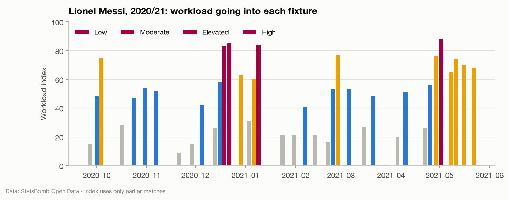

# Workload methodology

The Workload Index summarises how much a player has been asked to play
recently. It is **not** a fatigue, injury-risk or readiness-to-perform
measure, and the app never calls it one.
Code: `barca.analytics.workload`; analysis: notebook 11.

## Definition

For each player and Barcelona fixture, from appearances strictly before the
fixture date:

| Component | Weight | Reaches its maximum at |
|---|---|---|
| minutes in the last 7 days | 0.30 | 180 (two full matches) |
| minutes in the last 14 days | 0.25 | 360 (four full matches) |
| minutes in the last 30 days | 0.15 | 630 (seven full matches) |
| consecutive starts | 0.15 | 8 in a row |
| short rest since the last appearance | 0.15 | 2 days or fewer (zero at 7 days or more) |

Each component is scaled to 0-1 and capped, and the index is 100 × the
weighted sum, rounded. Bands:

| Band | Index |
|---|---|
| Low | below 35 |
| Moderate | 35-59 |
| Elevated | 60-79 |
| High | 80 and above |

The player panel shows each component's contribution in points, so any value
can be traced back to minutes and dates.

## Why fixed reference points

Scaling each component by its percentile across all seasons would be the
obvious alternative, but it would leak: a value in 2010 would depend on how
much players played in 2019. Fixed football reference points (two full
matches in a week) use no data at all, stay constant across eras and are
easy to explain.

## Coverage caveat

The data holds La Liga matches (most but not all of Barcelona's in each
season) and three Champions League finals. **Cup and European matches are
missing**, so the index measures **observed league workload** and
understates real load, most of all in congested winter and spring periods.
Minutes include stoppage time.

## What the analysis found

- Load concentrates on a spine of 6-8 players each season.
- **Observed workload does not predict rotation** once recent starts, form
  and opponent strength are held fixed: odds ratio 1.01 per +10 points
  (95% CI 0.96-1.06). The matches that drive rotation (cups, Europe) are
  the missing ones.
- **No measurable effect on performance**: within players, +20 index points
  changes the match rating by +0.009 (95% CI −0.014 to +0.032), tiny next to
  the one-point spread of match ratings. Coaches rotate before performance
  drops, so the overloaded matches that would show an effect were mostly
  never played.

Both results argue for presenting the index as a load summary for rotation
decisions, not as a predictor. It is still a feature of the starting-XI
model, where recent minutes and streaks matter.

## Team readiness

The overview page shows a **team readiness** score. It is a UI summary, not
a model, and the tooltip says so:

    readiness = 0.6 × form score + 0.4 × freshness

- *form score*: mean form rating (minutes-weighted mean match rating over
  the last five rated appearances) of the predicted XI, mapped linearly from
  5.5 → 0 to 8.0 → 100 and clipped;
- *freshness*: 100 − the mean Workload Index of the predicted XI.

Both inputs are pre-match values, so the score is as leak-free as the
features behind it.
