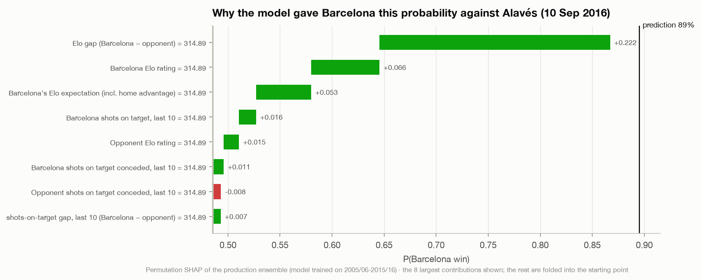
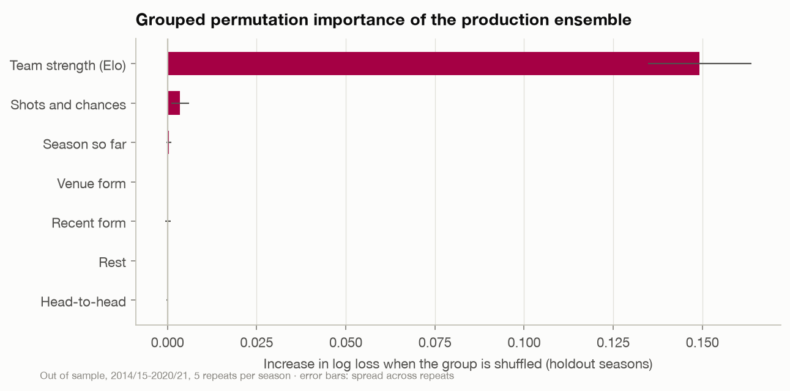
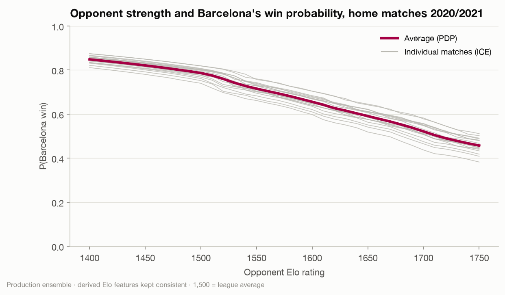

# Explainability methodology

Explanations serve three purposes here: tell a user why a prediction is what
it is, show which inputs the model relies on overall, and act as a check
that nothing leaked into the model. Methods and choices are recorded in
[D-028](decision-log.md#d-028---explanations-permutation-shap-of-the-shipped-model-plus-treeshap-and-grouped-importance);
the analysis is notebook 15.

## Local: "why 64%?"

**What is explained.** P(Barcelona win) from the production ensemble, the
model the app actually shows, not one of its members. Each fixture is
explained with the season-specific model that made its prediction, so the
explanation never uses a model trained on later data.

**Method.** Permutation SHAP (`shap.explainers.Permutation`) with an
independent masker. The background set is 100 rows sampled from that
model's own training data. Values satisfy SHAP's efficiency property:
base value + Σ contributions = the prediction, exactly, which the app
shows as "Average prediction 26% + contributions = 32%".

**Presentation.**
- Contributions are shown in percentage points of win probability.
- Features are labelled in football language ("Opponent Elo rating",
  "Barcelona goals scored, last 10") and shown **from Barcelona's side**. The
  model works in home/away terms, so for away matches home-minus-away
  differences are sign-flipped and "home" features are relabelled as the
  opponent's (`barca.xai.labels.barca_view`).
- The ten largest contributions are listed individually; all features are
  also summed into seven groups (team strength, recent form, shots and
  chances, venue form, season so far, head-to-head, rest).
- 494 Barcelona fixtures (2008/09-2020/21) are explained in advance by
  `barca explain` and stored with the predictions, so the app does no
  computation at request time.

**Why not TreeSHAP of LightGBM for this?** It would explain a model the app
does not show. KernelSHAP would work too, but it is slower and gives nothing
extra at 90 features.

## Global: what the model relies on

**Grouped permutation importance** on the holdout seasons, each with the
model trained before it: shuffle a group of related features together and
measure how much log loss rises. Grouping matters because many features are
near-duplicates (opponent Elo, Elo gap, Elo expectation); permuting one
while its twins stay intact understates what the group knows.

| Group shuffled | Log-loss increase |
|---|---|
| Team strength (Elo) | ≈ 0.149 |
| Shots and chances | ≈ 0.004 |
| Every other group | within noise of zero |

Team strength carries almost the whole model. That does not make form
irrelevant: Elo is already a form-weighted summary of every result, so
separate form features have little left to add once it is known.

**Mean |TreeSHAP| of the LightGBM member** tells the same story: the Elo
expectation and gap first, then both sides' ratings, the shots-on-target
gap, season goal difference and shot volumes. It is cheap to compute and
feeds the leakage audit below.

## Shape: PDP and ICE

Partial dependence of P(Barcelona win) on the opponent's Elo, over every
Barcelona home match of 2020/21. When the opponent's rating is set to a grid
value, the dependent features (Elo gap and Elo expectation) are rebuilt
consistently (`barca.xai.pdp.set_opponent_elo`), so the model never sees an
impossible combination. The curve is smooth and monotone, and the ICE
curves are nearly parallel: the effect has the same shape in every match and
only its level differs.

## Explainability as an audit

A deliberately leaky model (the same LightGBM plus the match's own shots and
shots on target) looks spectacular: accuracy jumps from about 50% to 60% and
log loss falls from 1.01 to 0.88, better than the betting market. Its
explanations give it away at once: the top features are post-match
quantities. `barca.xai.audit` automates the check by matching the top
features against patterns of post-match columns; it flags the leaky model
and passes the production model.

Together with the future-scrambling test and the feature-list test
([feature-engineering.md](feature-engineering.md#proving-there-is-no-leakage)),
that gives three independent guards against leakage.

## Error analysis: the confident misses

Among the 287 Barcelona fixtures where the model gave at least 70% to one
outcome, its own probabilities implied about 53 misses; there were 51. So
the confident misses are the ones a calibrated model should have. Of the 45
with event data:

| Situation | Share of confident misses | Share of all matches |
|---|---|---|
| Barcelona out-created the opponent (xG) | 69% | 84% |
| a Barcelona player was sent off | 20% | 6.9% |
| Messi not in the starting XI | 11% | 8.9% |

Most were good performances with bad outcomes: in 19, Barcelona produced
1.5+ xG and still did not win. Red cards, in-match information no pre-match
model can have, are three times over-represented. Messi's absence is not
meaningfully over-represented. The obvious next feature is expected lineup
strength, which the starting-XI model makes possible.

## Caveats

- Contributions describe the model, not football causality.
- Correlated features share credit; the grouped view is the more reliable
  reading.
- Permutation SHAP is a sampling estimate (400 evaluations per fixture);
  small contributions can move slightly between runs.
